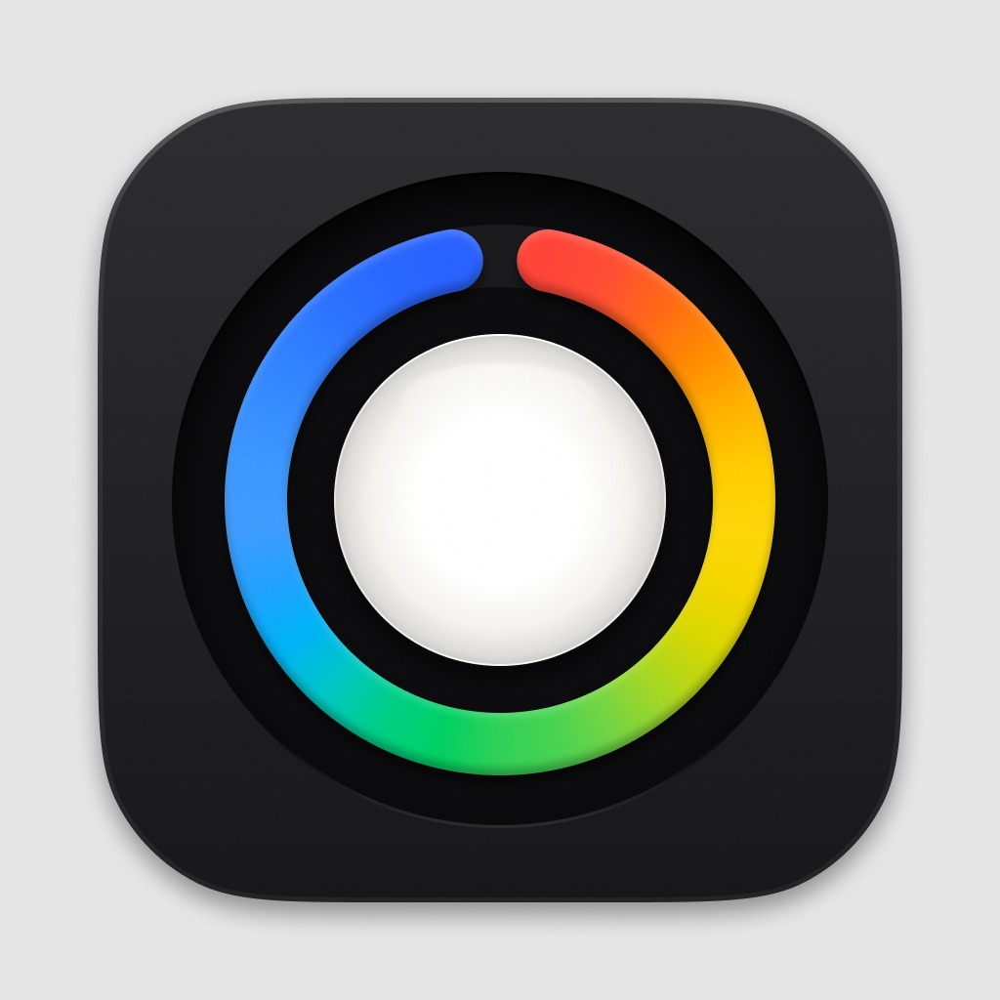

# Clocklin for Windows

**by LEVLIN LABS**

Setup guide, version 0.1.0

**In this guide**

1. [What is Clocklin?](#what-is-clocklin)
2. [What you need](#what-you-need)
3. [Install](#install)
4. [Start using it](#start-using-it)
5. [Optional: websites](#optional-also-see-which-websites-you-spend-time-on)
6. [Your privacy](#your-privacy)
7. [Update](#update)
8. [Uninstall](#uninstall)
9. [If something goes wrong](#if-something-goes-wrong)

## What is Clocklin?

Clocklin shows you where your time on the computer goes. It notices which app you are using, and you tell it which apps count as **On task**. Then it shows you your day and your week.

Everything stays on your own computer. Nothing is sent over the internet, and there is no account to create.

## What you need

- A PC with **Windows 11**.
- About 5 minutes.

## Install

**1. Download the installer**

Click this link: **[Download Clocklin](https://github.com/levlin-labs-official/timelin/releases/latest/download/Clocklin-Setup-0.1.0-x64.exe)**

The file is about 117 MB and goes to your **Downloads** folder.

**2. Open the file you downloaded**

Double-click `Clocklin-Setup-0.1.0-x64.exe` in your Downloads folder.

**3. If a blue "Windows protected your PC" box appears**

This is normal for a new app that Microsoft has not seen many times yet.

1. Click **More info**.
2. Click **Run anyway**.

**4. Follow the setup wizard**

The Clocklin Setup window opens. It works like any other installer:

1. **Welcome:** click **Next**.
2. **Licence:** read it and click **I Agree**.
3. **Install folder:** leave it as it is and click **Install**.
4. **Installing:** wait a few seconds.
5. **Finish:** keep **Run Clocklin** ticked and click **Finish**.

Setup does not ask for an administrator password. You will find a **Clocklin** icon on your Desktop and in the Start menu.

## Start using it

1. Open **Clocklin** from the Desktop or the Start menu.
2. Follow the **Getting started** page inside the app.
3. Use your computer as usual. Leave Clocklin open in the background; it only records while it is open.
4. Open the **Rules** page and choose which of your apps count as **On task**.

That is all you need. The next part is optional.

## Optional: also see which websites you spend time on

Without this step, Clocklin only knows "you were in Chrome". With it, Clocklin also knows which website. This works in **Google Chrome** and **Brave**. It does not work in Microsoft Edge or Firefox yet.

1. Open Chrome (or Brave).
2. Click the address bar at the top, type `chrome://extensions` and press **Enter**. In Brave, type `brave://extensions`.
3. At the top right of that page, switch on **Developer mode**.
4. Click the **Load unpacked** button that appears at the top left.
5. A folder window opens. Click its address bar at the top, paste the line below, and press **Enter**:

   ```
   %LOCALAPPDATA%\Programs\Clocklin\resources\browser-extension\chromium
   ```

   If you chose a different install folder during setup, open that folder instead, then `resources`, `browser-extension`, `chromium`.

6. Click **Select Folder**. "Clocklin" now appears in your list of extensions.
7. Go back to the Clocklin app, open **Settings**, and switch on **Record browser domains**.
8. In your browser, click the Clocklin extension icon (it may be inside the puzzle-piece menu at the top right) and turn recording on.

Clocklin only records the website's name, such as `youtube.com`. It never records the full page address, what you type, or what is on the page.

## Your privacy

- Your activity is saved in one file on your own computer.
- Clocklin does not send your activity anywhere and has no account or sign-in.
- You can erase everything at any time with **Delete all data** in the app.

## Update

1. Close Clocklin. If you did the optional website step, close your browser too.
2. Download the newest installer from the link above and run it, the same way as the first time.

Your history is kept.

## Uninstall

Clocklin comes with its own uninstaller. You run it from Windows, like any other app.

**1. Decide whether to keep your history**

Uninstalling keeps your saved history on the computer, in case you install Clocklin again. If you want it erased, open Clocklin first and use **Delete all data**.

**2. Close Clocklin and your browser**

**3. Run the uninstaller**

1. Open the **Start** menu and click **Settings**.
2. Click **Apps**, then **Installed apps**.
3. Find **Clocklin** (publisher: LEVLIN LABS). Click the three dots next to it and choose **Uninstall**.
4. Follow the short uninstall wizard to the end.

Clocklin, its Desktop icon and its Start menu entry are now gone.

**4. If you did the optional website step**

Open your browser's extensions page (`chrome://extensions` or `brave://extensions`), find **Clocklin**, and click **Remove**.

**5. Optional clean-up**

Setup keeps a copy of itself (about 117 MB) that the uninstaller does not delete. To remove it:

1. Press the **Windows key + R**.
2. Paste `%LOCALAPPDATA%` and press **Enter**.
3. Delete the folder named `clocklin-updater`.

## If something goes wrong

- **The download link shows "Not found".** Open the [Releases page](https://github.com/levlin-labs-official/timelin/releases) and click the file that ends in `.exe`.
- **Setup says Clocklin is still running.** Close Clocklin and your browser, then run Setup again.
- **Websites are not showing up.** Check steps 7 and 8 of the optional part: both switches must be on.
- **Anything else.** Ask the person who sent you this link.

## Good to know

- This is an early version, tested on Windows 11 only.
- Clocklin does not start by itself when you turn on your PC. Open it when you want it to record.

---

© 2026 LEVLIN LABS
